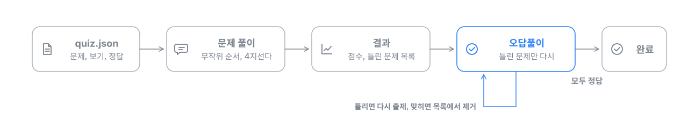
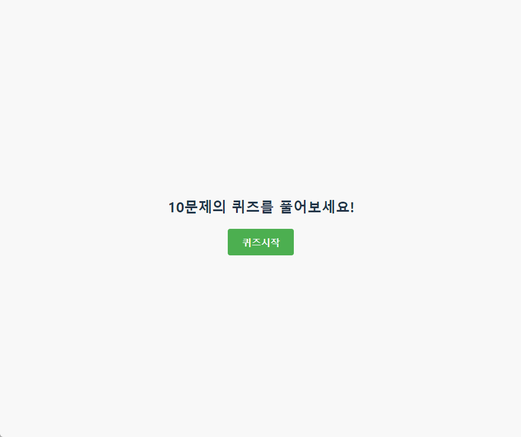

# JS Quiz App

JSON 파일의 문제로 4지선다 퀴즈를 내고, 틀린 문제만 모아 다시 풀게 하는 웹 앱입니다. Vue 3와 Vite로 만들었습니다.



## 주요 기능

- 문제 순서를 매번 무작위로 섞어 출제
- 정답과 오답을 바로 알림으로 표시
- 결과 화면에서 점수와 틀린 문제 목록 확인
- 오답풀이 모드: 틀린 문제만 다시 풀고, 맞히면 목록에서 제거
- 문제는 `my-quiz-app/public/quiz.json`만 고치면 추가하거나 바꿀 수 있음

## 실행 방법

```bash
cd my-quiz-app
npm install
npm run dev
```

## 문제 데이터 형식

```json
[
  {
    "question": "문제",
    "answers": ["보기 1", "보기 2", "보기 3", "보기 4"],
    "correct": 0
  }
]
```

`correct`는 `answers`에서 정답의 위치(0부터 시작)입니다. 들어 있는 예시 문제 10개는 ChatGPT로 만든 샘플입니다.

## 구조

- `my-quiz-app/src/Quiz.vue`: 출제, 채점, 오답풀이 로직과 화면
- `my-quiz-app/public/quiz.json`: 문제 데이터
- 알림 표시: `@kyvg/vue3-notification`

## 동작 화면


